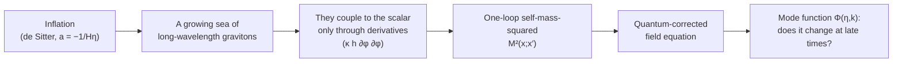
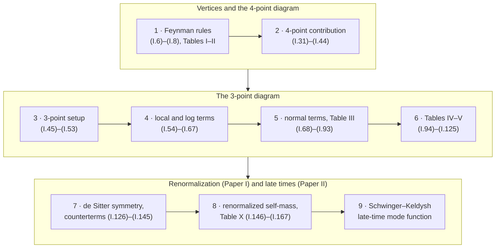

# Claude Audits Quantum Gravity

*An AI re-derived a published one-loop quantum gravity calculation step by step. It found a sign error and a missing term, and confirmed the physical conclusion.*

[](LICENSE)
[](code/requirements.txt)
[](code/README.md)

This repository re-derives, step by step, a published one-loop quantum gravity calculation during inflation:
the graviton correction to a massless, minimally coupled scalar on de Sitter space
([Paper I](#papers), Phys. Rev. D 76, 124005 (2007)), and its use in the scalar's late-time field equation
([Paper II](#papers), arXiv:0710.5282). The re-derivation was carried out with Claude (Anthropic's AI model,
Claude Opus 5.5) as a checking tool. It was published by E. O. Kahya, one of the authors of both papers.
Each step, from the Feynman rules (I.6)–(I.8) to the renormalized self-mass (I.167) and the late-time analysis of Paper II,
was derived again from the inputs stated in the papers, keeping the dimension $`D`$ general wherever the paper does, and
cross-checked with independent SymPy/mpmath code. (The bookkeeping tables of Paper I's appendix were audited rather than
redone; see [Limitations](#how-claude-was-used).) Every difference from the printed papers is classified: **4 substantive
findings (S1–S4), 6 finite errors absorbed into counterterms (B1–B6) and 23 typographical errors (C1–C23)**. The
[complete list of findings](docs/10-complete-list-of-findings.md) gives each one with its evidence.

**Bottom line:** the main physical conclusion of Paper II survives. The scalar's mode function receives no significant
one-loop correction at late times. However, the printed self-mass-squared is $`-1`$ times the one defined by Paper I's own
(I.168) (the 4-point and 3-point parts are both reversed, so their relative sign is consistent), and two entries of its
final table, Table X, need correcting.

**Contents:**
[The question](#the-question-in-one-picture) ·
[What was done](#what-was-done) ·
[Main results](#main-results-at-a-glance) ·
[Read it in order](#read-it-in-order) ·
[Complete list of findings](docs/10-complete-list-of-findings.md) ·
[Full derivations](#full-derivations) ·
[Reproduce the checks](#reproduce-the-checks) ·
[How Claude was used](#how-claude-was-used) ·
[Papers](#papers) ·
[Citation](#citation)

---

## The question in one picture



Inflation pulls long-wavelength quanta of massless fields that are not conformally invariant out of the vacuum.
Gravitons are such fields, so as inflation goes on the universe fills with an ever-growing sea of infrared gravitons.
The question is whether this sea changes how a massless, minimally coupled scalar (a stand-in for a very flat inflaton)
propagates. All quantum corrections at one loop are contained in the scalar self-mass-squared $`M^2(x;x')`$, which enters
the linearized effective field equation (Paper I, Eq. (I.168)):

```math
\partial_\mu\Big(\sqrt{-g}\,g^{\mu\nu}\,\partial_\nu\Phi\Big)(x)\;-\;\int d^4x'\;M^2(x;x')\,\Phi(x')\;=\;0 .
```

At tree level the plane-wave mode function freezes to a constant once the mode has left the horizon:

```math
u(\eta,k)=\frac{H}{\sqrt{2k^3}}\Big(1-\frac{ik}{aH}\Big)\exp\Big(\frac{ik}{aH}\Big)\;\underset{a\to\infty}{\longrightarrow}\;u(0,k)=\frac{H}{\sqrt{2k^3}} .
```

Write $`M^2=\kappa^2M^2_1+O(\kappa^4)`$ and $`\Phi=u+\kappa^2\Phi_1`$, with $`\kappa^2=16\pi G`$; $`\Phi_1`$ is sourced by
$`M^2_1`$, so $`\kappa^2`$ is counted once. Paper II asks whether
$`\Phi_1/u`$ grows at late times, for example like $`\ln a`$. The graviton sea is there, but at this order it can only couple to
the scalar through derivatives, and the derivatives of a frozen mode function vanish. Turning this intuition into a result
takes the *full* self-mass: two one-loop diagrams (a 4-point "seagull" and a 3-point diagram), dimensional regularization,
counterterms for a gauge that breaks part of the de Sitter symmetry, and finally the Schwinger–Keldysh (in-in) form of the
field equation.

## What was done

The two papers were split into **18 tasks**, which follow the papers' equations in order. They are grouped into nine stages,
each with a summary page, a chapter of derivation notes and a folder of code checks.



Each stage goes through the same steps: the analytic derivation (index by index, general $`D`$), then an independent code check
kept separate from it, then a comparison with the printed equations.

## Main results at a glance

> [!IMPORTANT]
> **Late-time answer: no significant one-loop correction.** With the *corrected* self-mass-squared, and without the
> simplification (II.44) of Paper II, the solution of the Schwinger–Keldysh mode equation approaches
>
> ```math
> \Phi(\eta,k)=u(\eta,k)+\kappa^2\,\Phi_1(\eta,k)\;\underset{a\to\infty}{\longrightarrow}\;u(0,k)\left\{1+\frac{\kappa^2H^2}{16\pi^2}\left[\,\tilde C+O\!\left(\frac{\ln a}{a^2}\right)\right]\right\}.
> ```
>
> $`\tilde C`$ is a constant (a field-strength renormalization). Nothing grows like $`\ln a`$, $`\ln^2 a`$ or $`a`$. None of the
> corrections below changes Paper II's conclusion. ($`\Phi_1`$ is sourced by the one-loop self-mass with $`\kappa^2`$
> stripped off, so $`\kappa^2`$ appears only once; $`\tilde C=16\pi^2C/H^2`$, where $`C\,u(\eta,k)`$ is the homogeneous part
> of $`\Phi_1`$.)

| | Finding | Type | Consequence |
|---|---|---|---|
| **S1** | The printed bare $`-iM^2`$ of Paper I is $`-1`$ times the one defined by Paper I's own definition (I.168). The 4-point part is reversed by the derivative rule used in (I.32); the 3-point part is reversed at the step (I.46) → (I.47)–(I.49). Both are reversed, so their relative sign is consistent. | substantive (overall sign) | The physical nonlocal part is $`-`$(corrected Table X). It flips every Table 5 entry of Paper II and the sign of $`\Phi_1`$; since the non-falling total is zero, only decaying terms change sign. No late-time effect. |
| **S2** | The $`(aa')^2\nabla^4`$ ($`\zeta`$) row of Table X lacks the Table III term $`8\ln x-16x\ln x`$. The correct row is $`\tfrac{34}{3}\ln x-40x\ln x+24x^2\ln x-36x^2`$ (printed: $`\tfrac{10}{3}\ln x-24x\ln x+24x^2\ln x-36x^2`$). | substantive (non-analytic) | Changes the physical nonlocal self-mass, but at late times it adds only falling terms: it removes the $`(k/H)^4/a`$, $`(k/H)^6/a`$ tails, so the right-hand side of the mode equation falls like $`\ln a/a^2`$. |
| **S3** | The constant of the $`(aa')^3(a^2+a'^2)H^4`$ row of Table X changes from $`-54`$ to $`+18`$ (a term equivalent to $`72\gamma_2`$ is missing from Table V). | substantive (analytic) | It is $`y`$-independent, so it drops out of the retarded Schwinger–Keldysh kernel identically. |
| **check** | Global test: the direct sum of all normal contributions against the Table X operators, at 3 pairs of points with 30 digits. | numerical | Agreement **only** when S2 and S3 are both applied. |
| **S4** | The justification of simplification (II.44) of Paper II fails term by term: two $`\nabla^2`$ rows each grow like $`\mp\tfrac{4}{15}(k/H)^2a`$ (definition sign), and these growing terms cancel between the two rows. Without (II.44), the non-falling part of the right-hand side still cancels order by order through $`k^{10}`$, for the corrected and for the printed table. At order $`k^4`$ this needs the $`24x^2\ln x`$ term of the $`\zeta`$ row, which (II.44) drops; that term is the same in the printed and in the corrected row. | justification fails, result holds | The late-time result above. |
| **B1–B6** | Finite counterterm coefficients (paper convention, units $`H^{D-4}/(4\pi)^{D/2}`$): $`\beta_2:-\tfrac{61}{3}\to-\tfrac{49}{3}`$ and $`\beta_3:+\tfrac{58}{3}\to+\tfrac{52}{3}`$, and the corresponding shifts in $`\alpha_2,\alpha_3`$ of Paper II, (II.8)–(II.9). The pole $`-4/(D-4)`$ is unchanged and $`\beta_1=0`$. These come from slips in (I.40) and in the arithmetic of (I.59). | absorbable | Absorbed into the finite counterterms $`\Delta\alpha_2,\Delta\alpha_3`$. No physical effect. |
| **II** | Paper II: Tables 2–4 (12 integrals) are reproduced exactly. Table 5 (19 entries) is reproduced in the paper's convention; every entry flips with the definition sign, and the total is still 0. | agreement | — |
| **C1–C23** | 23 typographical errors in the two papers (listed below). | typo | None. |

Table entries are quoted in the paper's sign convention, as printed. S1 then multiplies the whole of Table X by $`-1`$.
The [complete list of findings](docs/10-complete-list-of-findings.md) gives every item (Tables A–E) with its evidence, the
conventions, a summary for non-experts, and the limitations.

The renormalized self-mass-squared, in the sign fixed by Paper I's own definition (I.168), at $`D=4`$ with $`x=y/4`$, is

```math
-iM^2_{\rm ren}(x;x')=i\kappa^2a^4\Big(\Delta\alpha_1\,\square^2+\Delta\alpha_2\,H^2\square+\Delta\alpha_3\,H^2\frac{\nabla^2}{a^2}\Big)\delta^4(x-x')\;-\;\big[\text{corrected Table X}\big](x;x') .
```

<details>
<summary><b>The 23 typographical errors C1–C23</b> (no effect on any result)</summary>

C1–C19, C22 and C23 are in Paper I; C20 and C21 are in Paper II.

- **C1** (I.1): the first term has $`\partial_\mu\phi\,\partial_\mu\phi`$ instead of $`\partial_\mu\phi\,\partial_\nu\phi`$.
- **C2** (I.6), left-hand side: the second $`\phi`$ is missing.
- **C3** (I.7), left-hand side: $`-\tfrac12\kappa`$ should be $`+\tfrac12\kappa`$. The vertex itself is correct.
- **C4** (I.14): the first coefficient should be $`\Gamma(\tfrac D2-1)`$.
- **C5** Table II, $`U_2`$: $`-\tfrac i4`$ should be $`+\tfrac i4`$. The paper's own (I.33) uses $`+\tfrac i4`$.
- **C6** (I.39): index placement ($`\bar\eta_{\rho\sigma}`$ for $`\bar\eta^{\rho\sigma}`$; same matrix).
- **C7** The text before (I.54) refers to "the 4th term of (47)"; it should be the 2nd term.
- **C8** (I.89): a factor $`H^2`$ is missing in the second term. Table III is correct.
- **C9–C13** Five typos in the appendix "Extracting derivatives": the Table XII header, (A18), Table XIII row $`P_{7c}`$, Table XV row $`P_{4b}`$ and the Table XVIII total.
- **C14** (I.128): the list of four-derivative invariants omits $`\phi^2R_{\mu\nu\rho\sigma}R^{\mu\nu\rho\sigma}`$ and $`\phi^2\square R`$; shift symmetry removes both, so (I.129) is unaffected.
- **C15** Table IV, $`\gamma_2`$ entry: wrong sign. Tables VI–IX use the correct sign, which shift symmetry requires.
- **C16** Table VII header: spurious factor $`i`$.
- **C17, C18** (I.160) and (I.167): $`H^2`$ is missing next to $`\beta_2,\beta_3`$ and $`\Delta\alpha_2,\Delta\alpha_3`$.
- **C19** Table X prints the row $`(aa')^2(a^2+a'^2)\nabla^2\square`$ twice.
- **C20, C21** (II.10) and (II.34): $`H^2`$ is missing next to $`\Delta\alpha_2,\Delta\alpha_3`$ (the same omission as in (I.160) and (I.167)).
- **C22** (I.170): the same missing $`H^2`$ next to $`\Delta\alpha_2,\Delta\alpha_3`$, and in the result $`-\kappa^2a^4\Delta\alpha_3H^2k^2/a^2\,\Phi_0`$.
- **C23** Appendix, text before (A31): "to $`P_1`$ and $`P_6`$" should read "to $`P_1`$ and $`P_4`$".

C22 and C23 were noticed while refereeing the write-up and confirmed on the printed pages. Details, with the evidence for
each item, are in the [complete list of findings](docs/10-complete-list-of-findings.md#table-c-typographical-errors).

</details>

## Read it in order

Each page tells the story of one stage first, then gives the key equations, the result, a comparison table with the
paper, and links to the code and to the full derivation.

1. [**Feynman rules**](docs/01-feynman-rules.md): expand $`\sqrt{-g}\,g^{\mu\nu}`$ to second order in $`\kappa`$ and get the scalar–graviton vertices (Tables I–II). *Tasks 1–2.*
2. [**The 4-point contribution**](docs/02-four-point.md): the seagull diagram, the coincidence limits in dimensional regularization, and where the overall sign comes from. *Tasks 3–5.*
3. [**3-point setup**](docs/03-three-point-setup.md): the effective action, the nine terms after the graviton propagator is inserted, and the mixed derivative of the scalar propagator (I.52). *Tasks 6–8.*
4. [**3-point local and logarithm terms**](docs/04-three-point-local-and-log.md): the local divergences, the de Sitter-breaking $`\ln(aa')`$ terms, and their exact cancellation against the 4-point terms. *Tasks 9–10.*
5. [**Normal terms and Table III**](docs/05-normal-terms-table-III.md): how derivatives are pulled outside, the time-derivative identities, and Table III. *Tasks 11–12.*
6. [**Tables IV and V**](docs/06-tables-IV-V.md): the ten external operators, the appendix bookkeeping, and the missing $`72\gamma_2`$ term. *Task 13.*
7. [**de Sitter symmetry and counterterms**](docs/07-de-sitter-symmetry-and-counterterms.md): which isometries the gauge preserves, and why one noninvariant counterterm suffices. *Tasks 14–15.*
8. [**Renormalized self-mass and Table X**](docs/08-renormalized-self-mass-table-X.md): separating the divergences, the coefficients $`\beta_i`$, Table X, and the global pointwise test. *Tasks 16–17.*
9. [**Schwinger–Keldysh and late times**](docs/09-schwinger-keldysh-late-time.md): Paper II with the corrected self-mass, Tables 2–5, going beyond (II.44), and the late-time mode function. *Task 18.*
10. [**Complete list of findings**](docs/10-complete-list-of-findings.md): every result in one place: the substantive findings S1–S4, the absorbable errors B1–B6, the typographical errors C1–C23, what was confirmed as printed, the late-time results, a summary for non-experts, and the limitations. *All tasks.*

## Full derivations

The complete derivation (every step, the index tracking, intermediate results, comparison tables and a calculation record
for each task) is in **[`notes/notes.pdf`](notes/notes.pdf)**. Its LaTeX sources are in [`notes/`](notes/): one file per chapter
in [`notes/chapters/`](notes/chapters/) and the shared macros in `notes/macros.tex`.

| Chapter | Title | Tasks |
|---|---|---|
| 1 | Lagrangian expansion and Feynman rules: Eqs. (I.6)–(I.8), Tables I–II | 1–2 |
| 2 | The 4-point contribution: Eqs. (I.31)–(I.44) | 3–5 |
| 3 | The 3-point contribution: setup and Eqs. (I.45)–(I.53) | 6–8 |
| 4 | 3-point local and logarithm terms: Eqs. (I.54)–(I.67) | 9–10 |
| 5 | Normal contributions and Table III: Eqs. (I.68)–(I.93) | 11–12 |
| 6 | Tables IV and V: Eqs. (I.94)–(I.125) | 13 |
| 7 | de Sitter symmetries, the gauge, and noninvariant counterterms: Eqs. (I.126)–(I.145) | 14–15 |
| 8 | Renormalization and the final self-mass: Tables VI–X, Eqs. (I.146)–(I.167) | 16–17 |
| 9 | Schwinger–Keldysh mode equation and the late-time mode function (Paper II) | 18 |
| 10 | Summary of findings: every discrepancy, classified, with a pointer to its derivation | all |

A reader-friendly version of the findings, with the same IDs (S1–S4, B1–B6, C1–C23), is
[`docs/10-complete-list-of-findings.md`](docs/10-complete-list-of-findings.md).

In the notes, each statement carries a label: **P** (given in the paper), **D** (derived here), **A** (assumption or
convention) or **C** (an independent cross-check, by code unless stated otherwise). Each equation states which sign convention it uses: the paper's, or the definition
sign of (I.168). To build the PDF yourself: `cd notes && tectonic -X compile notes.tex`.

## Reproduce the checks

```bash
git clone https://github.com/eokahya/claude-audits-quantum-gravity.git
cd claude-audits-quantum-gravity
pip install -r code/requirements.txt      # sympy, mpmath

python3 code/run_all.py --quick           # all but the two slowest scripts, about 6 minutes
python3 code/run_all.py                   # everything (38 runs), about 10 minutes
python3 code/run_all.py --folder 08       # one folder
```

[`code/run_all.py`](code/run_all.py) runs every script from inside its folder and compares its output with the stored
`expected_output/`. At the end it prints a pass/fail table. The stored outputs were produced with Python 3.13.1, SymPy 1.14.0
and mpmath 1.3.0, and they are identical to the outputs recorded during the original calculation. Another SymPy version may
print an equivalent expression in a different form; in that case the comparison shows a diff. In the last full run
(Apple-silicon Mac) all 38 runs passed in 10 minutes.

You can also run a single check by hand from its folder:

| Folder | Example |
|---|---|
| [`01_feynman_rules`](code/01_feynman_rules/) | `cd code/01_feynman_rules && python3 check_vertices.py` |
| [`02_four_point`](code/02_four_point/) | `cd code/02_four_point && python3 check_4pt.py` |
| [`03_three_point_setup`](code/03_three_point_setup/) | `cd code/03_three_point_setup && python3 check_47_49.py` |
| [`04_three_point_local_log`](code/04_three_point_local_log/) | `cd code/04_three_point_local_log && python3 check_60_67.py` |
| [`05_normal_terms_tableIII`](code/05_normal_terms_tableIII/) | `cd code/05_normal_terms_tableIII && python3 check_81_93.py` |
| [`06_tables_IV_V`](code/06_tables_IV_V/) | `cd code/06_tables_IV_V && python3 check_tables45b.py` |
| [`07_desitter_counterterms`](code/07_desitter_counterterms/) | `cd code/07_desitter_counterterms && python3 check_136_145.py` |
| [`08_renormalization_tableX`](code/08_renormalization_tableX/) | `cd code/08_renormalization_tableX && python3 check_tableX_global.py` |
| [`09_schwinger_keldysh`](code/09_schwinger_keldysh/) | `cd code/09_schwinger_keldysh && python3 kexp.py 10` |

[`code/README.md`](code/README.md) lists every script, what it checks and how long it takes. Each folder has its own README,
which explains how to read the output.

## How Claude was used

**Method.**

- **Inputs, not targets.** Each task took as input only the results of earlier tasks and the definitions and conventions
  stated in the papers. The printed equation to be checked was not used as an input; it was compared only after the
  derivation was finished. The exceptions: Tables IV–V were computed from the printed appendix totals after those totals
  had been checked, and Table V enters the assembly of Table X as printed (its non-analytic terms were confirmed first).
  Tables 2–5 of Paper II were never used as input.
- **General $`D`$.** Wherever the paper keeps the spacetime dimension general, so did the derivation. Every step was written
  out with explicit index tracking.
- **Code checks are separate from the analysis.** Each analytic result was then tested by independent SymPy/mpmath code:
  exact symbolic identities in general $`D`$ or at several fixed $`D`$, brute-force differentiation compared with the paper's
  reduced forms, and pointwise evaluation at random points with 20–30 significant digits. Code checks are labelled
  separately and never replace a derivation.
- **Finding the origin of each discrepancy.** When a result disagreed with the paper, the cause was traced back. For example,
  the overall sign comes from the derivative rule in (I.32) and from the step (I.46) → (I.47). Each discrepancy was
  classified as a typo, absorbable (a finite change absorbed by counterterms), substantive, or a convention.
- **Language and provenance.** The original working reports, one per task, were written in Turkish (HTML with KaTeX), together
  with a full log of every script run. The English notes, the docs pages and this README are faithful translations and
  summaries of those reports, also written with Claude. Each English chapter was then checked against its Turkish source in
  a separate Claude review pass. The scripts were cleaned up so that each one runs on its own, re-run, and compared with the
  original logs; the outputs agree.

**What a human expert should still review.**

- The two sources of the overall sign: Lemma A for the 4-point term ([docs/02](docs/02-four-point.md)) and the step
  (I.46) → (I.47)–(I.49) ([docs/03](docs/03-three-point-setup.md)). Both are short.
- Corrections S2 and S3 and the global test that supports them,
  [`check_tableX_global.py`](code/08_renormalization_tableX/check_tableX_global.py). In particular, check how the direct
  sum is built in its helper `check_global.py`.
- The late-time analysis: the exact $`k`$-expansion ([`kexp.py`](code/09_schwinger_keldysh/kexp.py)) and the solution for $`\Phi_1`$.
- The translation from the Turkish reports, if you read Turkish.

**Limitations and open points.**

- The appendix "Extracting derivatives" of Paper I was **audited, not redone from scratch**. We checked worked example rows
  by hand and all ten table totals with the global pointwise test; Tables XII and XIV and (A1)–(A9) were read from the
  printed pages. (One working report claimed that every row had been reproduced by hand. That claim was an overstatement
  and is corrected in the notes.)
- A possible extra **local** term from the appendix's operator reduction is only partly resolved. Any double counting of the
  local part has exactly the counterterm form $`c\,(a^D\square-a^{D-2}\nabla^2)\delta^D(x-x')`$, so it is absorbed into
  $`\alpha_2,\alpha_3`$. We have not proved, however, that no other local term arises; that needs a full distributional
  analysis.
- The global checks are **numerical at sample points**: two or three random spacelike point pairs, 30 digits, for Table X
  and for Tables IV–V with the actual propagators. They are **not symbolic identities**, and they check only sums.
  They cannot tell apart equivalent placements of the S3 term (a $`-12x`$ in the $`\delta`$ row of Table V, or a changed
  $`\gamma_2`$ constant).
- The Schwinger–Keldysh cancellation of the non-falling terms is exact through $`k^{10}`$. Beyond that there is a
  convergent-series argument but **no all-orders proof**.
- The $`a^{-2}`$ coefficients of the late-time solution depend on the initial state. As Paper II notes, falling terms cannot
  be trusted without the corrected initial state.
- Some code checks run only at fixed dimensions: counterterm completeness at $`D=4,5,6`$, the gauge-breaking
  Euler–Lagrange check in $`D=3`$, the pointwise check of the nonlocal part of (I.60)–(I.67) at $`D=4`$. The general-$`D`$
  statements rest on the analytic derivation.
- The overall sign (S1) rests on the paper's own definition (I.168). Once (I.168) is adopted, the sign of the nonlocal part
  is physical, because the nonlocal part has no counterterm freedom.
- Assumptions shared with the paper: dimensional regularization preserves the shift symmetry and the residual symmetries
  of the gauge-fixed action, ultraviolet divergences are polynomial in $`H`$, and $`D=4`$ is set only in terms not
  multiplied by a pole.

The full list of limitations is at the end of the [complete list of findings](docs/10-complete-list-of-findings.md#methodological-notes-and-limitations).

## Papers

- **Paper I.** E. O. Kahya and R. P. Woodard, "Quantum gravity corrections to the one loop scalar self-mass during
  inflation", *Phys. Rev. D* **76**, 124005 (2007). [doi:10.1103/PhysRevD.76.124005](https://doi.org/10.1103/PhysRevD.76.124005),
  [arXiv:0709.0536](https://arxiv.org/abs/0709.0536).
- **Paper II.** E. O. Kahya and R. P. Woodard, "Scalar field equations from quantum gravity during inflation",
  *Phys. Rev. D* **77**, 084012 (2008). [doi:10.1103/PhysRevD.77.084012](https://doi.org/10.1103/PhysRevD.77.084012),
  [arXiv:0710.5282](https://arxiv.org/abs/0710.5282).

Equations are cited as (I.*n*) for Paper I and (II.*n*) for Paper II. This repository contains no scans or figures from
the papers; where a printed equation is compared, it is retyped in LaTeX.

## Citation

If you use this re-derivation, please cite the original papers and this repository:

```bibtex
@misc{Kahya2026ClaudeAuditsQG,
  author       = {Kahya, Emre Onur},
  title        = {Claude Audits Quantum Gravity: a step-by-step {AI} re-derivation of a one-loop quantum gravity calculation during inflation},
  year         = {2026},
  howpublished = {\url{https://github.com/eokahya/claude-audits-quantum-gravity}},
  note         = {Step-by-step re-derivation of the one-loop scalar self-mass during inflation
                  (Phys. Rev. D 76, 124005) and of its late-time effect (arXiv:0710.5282),
                  carried out with Claude Opus 5.5}
}
```

## License

MIT. See [LICENSE](LICENSE).
